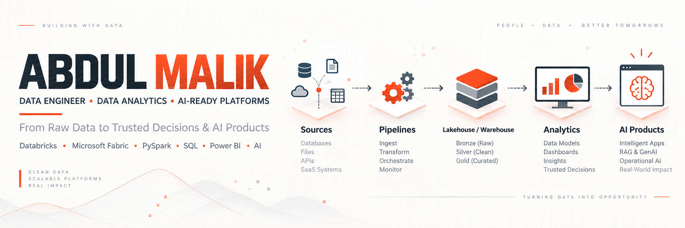

  
  
  
  
  

# I build reliable data platforms for analytics and AI—and explain how the architecture works.

I am an Associate Data Engineer in Chennai, India, working across data engineering, analytics, and modern lakehouse platforms. My work spans SQL, Python, Databricks, PySpark, Delta Lake, Microsoft Fabric, data pipelines, data modeling, and Power BI.

I learn in public through implementation, architecture documentation, workshops, and visual explainers. The thread across the work is simple: **I build, understand, document, and communicate.**

## Professional impact

| Scope | Evidence-led snapshot |
|---|---|
| **Associate Data Engineer · Systech Solutions Pvt. Ltd.** | Since April 2026, contributing to data-platform work that supports reporting, analytics, and AI-oriented workloads. Employer and client details are intentionally kept confidential. |
| **Data Analyst · Arcadia** | April 2024–August 2025, building an analytics foundation across SQL, Python, Power BI, data modeling, and business-facing reporting. |
| **Public technical work** | Building and studying lakehouse architectures, documenting engineering decisions, and translating data systems for technical and non-technical audiences. |

## Selected proof of work

### [Indian Agricultural Market Intelligence Platform](https://github.com/Abdulmalik25/Indian-agri-market-intelligence-fabric)

A documented Microsoft Fabric architecture that brings together pricing files in Azure Blob Storage, master data in Azure SQL, and geolocation and weather REST APIs. It covers Fabric Data Pipelines, PySpark and Delta Lake, Bronze and Silver layers, watermark-based incremental processing, SCD Type 1 and Type 2, a Fabric Warehouse, semantic modeling, and Power BI reporting.

The repository explains the data flow, orchestration, validation, control framework, and engineering decisions. It is **technical documentation and implementation evidence**; the original datasets and reproducible project artifacts are not included.

### Databricks AI, Lakebase, and MCP — a progressive public learning system

These forked repositories form one three-stage learning sequence rather than three unrelated demos:

1. **[Day 1: Databricks Apps + Lakebase](https://github.com/Abdulmalik25/databricks-lakebase-app-day-1)** — a Flask app, external API ingestion, batched synchronization, application state in Lakebase, and a watchlist workflow.
2. **[Day 2: retrieval context](https://github.com/Abdulmalik25/databricks-lakebase-app-day-2)** — news ingestion, document and chunk embeddings, pgvector-backed retrieval context, and scheduled Databricks workflows for vector-search/RAG concepts.
3. **[Day 3: MCP + Agent Bricks](https://github.com/Abdulmalik25/databricks-lakebase-app-day-3)** — MCP tools, an Agent Bricks workflow, Alpaca paper-trading integration, and a monitoring dashboard.

All trading activity described in Day 3 is **paper trading with simulated money**, never live financial trading.

### [How Data Becomes Business Decisions and AI Products](https://github.com/Abdulmalik25/How-Data-Becomes-Business-Decisions-and-AI-Products)

An [interactive explainer](https://abdulmalik25.github.io/How-Data-Becomes-Business-Decisions-and-AI-Products/) that connects sources, pipelines, lakehouse layers, analytics, and AI products into one navigable data ecosystem. It is proof that I can explain the complete architecture to both technical and non-technical audiences—not just build individual components.

### [TNEA Counselling Seat Availability Dashboard](https://github.com/Abdulmalik25/TNEA-Counselling-Seat-Availability-Dashboard)

A student-first Streamlit utility for exploring engineering-seat availability by district, college, branch, reservation type, and category. It provides filters, bar and pie summaries, and downloadable CSV results from the supplied datasets. This is an **interactive seat-availability dashboard**, not a continuously updated real-time feed.

## Earlier analytics foundation

| Project | Core technology | Public proof |
|---|---|---|
| [OTT Platform Analytics](https://github.com/Abdulmalik25/OTT-Platform-Analytics-LioCinema-Jotstar-Merger) | SQL, Power BI | Dashboard screenshots and an analytical narrative covering content, subscribers, inactivity, plan changes, and revenue. |
| [AtliQ Retail Promotional Analysis](https://github.com/Abdulmalik25/Atliq_Retail_Promotional_Analysis) | SQL, Power BI | Dashboard and query-result screenshots that document store, promotion, category, and product analysis. |
| [Pima Indian Diabetes Prediction](https://github.com/Abdulmalik25/Pima-Indian-Diabetes-Prediction-System) | Python, scikit-learn, Streamlit | Notebook, trained artifacts, application code, model comparisons, and an interactive prediction interface. |
| [YouTube SQL Analysis](https://github.com/Abdulmalik25/Youtube_SQL_analysis) | MySQL | A documented schema, business questions, and query-result screenshots; SQL scripts are not included in the repository. |

## Engineering toolkit

| Capability | Technologies and patterns used |
|---|---|
| **Data engineering platforms** | Databricks, Microsoft Fabric, Fabric Data Pipelines, ADF fundamentals |
| **Processing** | Python, SQL, PySpark, Apache Spark, REST APIs |
| **Lakehouse and storage** | Delta Lake, Lakebase, Unity Catalog, SQL Server, MySQL, Snowflake |
| **Data modeling** | Medallion architecture, dimensional modeling, SCD Type 1 and Type 2, semantic models |
| **Analytics and BI** | Power BI, DAX, reporting-ready data models |
| **AI-data systems** | Streamlit, Vector Search, RAG, MCP, Agent Bricks |

This is a working toolkit, not a claim of equal mastery across every technology.

## Certifications and recognition

I list credentials here only after the issuer, date, and public credential URL have been verified.

<!--
### Microsoft Certified: Fabric Data Engineer Associate

- Issuer: Microsoft
- Credential: Fabric Data Engineer Associate
- Credential URL: ADD_VERIFIED_MICROSOFT_CREDENTIAL_URL
- Date earned: ADD_MONTH_AND_YEAR

Uncomment this entry only after the certification has been earned and the credential URL has been verified.
-->

<!--
### Professional certification

- Issuer: ADD_ISSUER
- Credential: ADD_CERTIFICATION_NAME
- Credential URL: ADD_VERIFIED_CREDENTIAL_URL
- Date earned: ADD_MONTH_AND_YEAR

Uncomment only after every field and the credential URL have been verified.
-->

<!--
### Employer recognition or award

- Organization: ADD_EMPLOYER
- Recognition: ADD_AWARD_NAME
- Evidence URL: ADD_VERIFIED_EVIDENCE_URL
- Date received: ADD_MONTH_AND_YEAR

Uncomment only when the recognition can be shared publicly and the evidence URL has been verified.
-->

<!--
### Technical training credential

- Provider: ADD_PROVIDER
- Program: ADD_TRAINING_NAME
- Credential URL: ADD_VERIFIED_CREDENTIAL_URL
- Date completed: ADD_MONTH_AND_YEAR

Uncomment only after every field and the credential URL has been verified.
-->

## Building in public now

- Extending the **30 Days of Databricks** learning series from application state and ingestion toward retrieval context, MCP tools, and agent workflows.
- Developing and documenting Microsoft Fabric lakehouse patterns for incremental processing, dimensional history, orchestration, and BI-ready models.
- Exploring the data foundations behind AI applications while keeping the engineering, limitations, and evidence visible.

## Teaching is part of the engineering

I use workshops, architecture walkthroughs, visual explainers, and build-in-public notes to make data engineering understandable. Clear documentation is not an afterthought: it makes systems easier to review, operate, teach, and improve.

## Let’s connect

If you are building reliable data foundations for reporting, analytics, or AI—and value engineers who can communicate the system as clearly as they build it—reach me on [LinkedIn](https://www.linkedin.com/in/abdulmalik2001/) or at [abdul.malikite@gmail.com](mailto:abdul.malikite@gmail.com).
